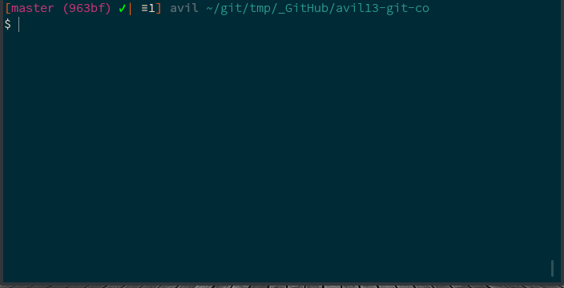

# avil13/co

Interactive Git branch checkout, merge, deletion, synchronization and stash management.



## Install

```sh
npm install -g avil13-co
```

## Usage

```sh
co                  # Search for a branch and check it out
co - 1234           # Pre-fill the editable search input with "1234"
co m                # Show merged branches (also: -sm, --show-merged)
co un               # Show unmerged branches (also: -un, --no-merged)
co -M               # Merge a selected branch (also: merge)
co -D               # Delete multiple local branches (also: rm)
co -p               # Fetch and safely sync all local branches (like hub sync)
co -s               # List and manage stashes (also: --stash)
co -h               # Show help
```

Search is case-insensitive and supports subsequences; special characters are literal.
Filters also work with commands, for example `co -M - 1234` or `co -D - 1234`.
For deletion, the initial filter restricts the checkbox list.

### Delete branches

Use **Space** to select branches, then **Enter** to confirm the selection.
A separate confirmation defaults to **No**. Only local branches are listed;
the current branch is excluded. Like Git's `-D`, this explicitly requested
operation can delete unmerged branches. Failures are reported per branch,
without skipping the remaining selections.

### Merge

After a successful, confirmed merge, `co` offers to delete the source branch
with **Yes** as the default (`[Y/n]`). This uses safe deletion (`git branch -d`),
not forced deletion. Remote-only branches are not offered for deletion.
A failed merge never triggers the deletion question.

### Stash

`co -s` or `co --stash` lists stash entries, newest first, with their dates and
messages. Select an entry to see its creation date, author, commit hash and
change statistics (including untracked files saved in the stash).

Choose **Apply** to restore changes and keep the stash, **Pop** to restore and
remove it on success, or **Delete** to remove it without applying. Deletion asks
for confirmation `[n/Y]`: Enter confirms, `n` cancels. A failed pop keeps the
stash, including when Git reports conflicts. Git errors end the command with
exit code 1; resolve any conflicts before trying again.

Use **Back to stash list** to select another entry, or **Exit** to leave without
changes. The list refreshes after deletion. Optional filtering is supported:
`co -s - search text` matches the reference, date or message.

### Synchronize branches

`co -p` works like `hub sync`, without requiring `hub`:

- Fetches all remotes with `--prune`.
- Fast-forwards local branches to their configured upstreams, including branches
  that are not currently checked out. It does not create merge commits or rebase.
- Without an upstream, uses the same-named branch on `origin`, or a unique match
  on another remote. Ambiguous matches are skipped; tracking configuration is not changed.
- Warns about unpushed commits or diverged history and leaves those branches unchanged.
- Safely deletes branches whose remote upstream disappeared only when they are
  merged into the current `HEAD`. Unmerged and checked-out branches are kept.
- Skips updating the current branch if the working tree is dirty, and never updates
  branches checked out in other worktrees.

This command synchronizes **all** local branches without a selection prompt and
accepts no search filter. It never pushes, force-resets, or stashes changes.
Network and Git failures are reported with exit code 1; skipped branches are
reported without treating them as failures.

### Cancel and errors

**Ctrl+C** exits with code 130 and restores the previous terminal screen,
removing this session's interactive output. Completed Git operations are not
rolled back. On normal completion, command results remain visible.
Screen switching is only enabled in an interactive terminal.

Git errors are printed without an unhandled rejection and return exit code 1.
Git is invoked directly, without shell interpolation of branch names.

## Development

```sh
npm test
npm run type-check
npm run build
```
